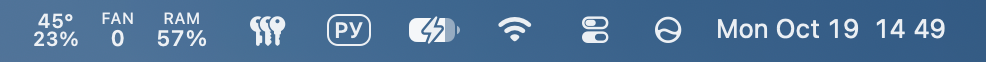
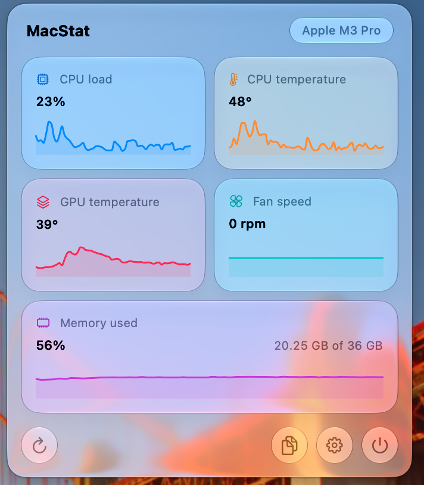
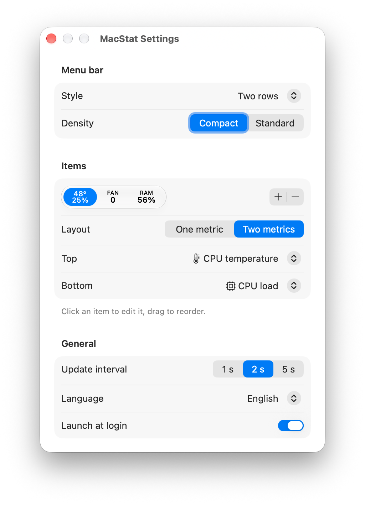

# MacStat

A lightweight menu bar monitor for Apple Silicon Macs: CPU load, CPU and GPU temperature, chip power, fan speed, battery temperature and memory use, right next to the clock.



## Features

- **Live menu bar readings.** Pick the metrics you want and the order they appear in. Show each one on its own, or stack two in a single column to save space.
- **Three menu bar styles:** two rows, icons and values, or icon only. Compact and standard density.
- **Persistent history.** Choose 1, 6, 24 or 48 hours. Minute averages and temperature peaks survive restarts; gaps after sleep remain gaps. History stays on your Mac.
- **Thermal state.** A badge shows the state reported by macOS, with a menu bar warning only for serious or critical conditions.
- **Memory pressure.** See the system pressure level, swap and compressed memory alongside memory use.
- **Battery details.** On supported Macs, see health, cycle count, signed battery power and the connected adapter rating.
- **Top processes.** The three leading CPU and memory consumers appear while the popover is open. App helpers are grouped; CPU is measured as a percentage of one core.
- **Copy summary.** Copy all current readings as plain text in one click.
- **Launch at login**, with an update interval of 1, 2 or 5 seconds.
- **Localized** in English, Russian, French, Spanish, Arabic and Traditional Chinese. You can switch the app language in Settings without changing the system language.
- **Native and private.** Built with SwiftUI and Swift Charts, with no third-party dependencies, no network access and no analytics.

<p align="center">
  
  
</p>

## Requirements

- macOS 27 or later
- A Mac with Apple Silicon

## Installation

1. Download the latest `MacStat-<version>.dmg` from [Releases](../../releases).
2. Open the disk image and drag **MacStat** to **Applications**.
3. Open MacStat. The app is not notarized, so on first launch macOS will block it. Open **System Settings → Privacy & Security** and click **Open Anyway** next to the MacStat message.

MacStat has no Dock icon. It lives in the menu bar only; quit it from the popover.

## Building from source

You need Xcode 27 or later.

```bash
git clone https://github.com/IlyaPavl/MacStat.git
cd MacStat
open MacStat.xcodeproj
```

To build an ad-hoc signed disk image in `build/`:

```bash
./make_dmg.sh
```

To run the unit tests:

```bash
xcodebuild -project MacStat.xcodeproj -scheme MacStat -destination 'platform=macOS' test -only-testing:MacStatTests
```

## How it works

- **CPU load** comes from Mach host statistics (`host_statistics` with `HOST_CPU_LOAD_INFO`).
- **Memory** comes from `host_statistics64` with `HOST_VM_INFO64`.
- **Temperatures and fan speed** are read from the System Management Controller (SMC) through IOKit. MacStat discovers the available sensors on first use and averages them per group, so the same build works across Apple Silicon generations.
- **Chip power** is the SMC estimate of the power the whole chip dissipates (`PHPC`), in watts.
- **Battery temperature** averages the SMC battery sensors (`TB0T`, `TB1T`…). It is hidden on Macs without a battery, just like fan speed on Macs without a fan.
- **Thermal state** uses `ProcessInfo.thermalStateDidChangeNotification`, not a polling timer. It describes thermal pressure and does not by itself establish throttling.
- **Memory pressure and swap** come from `kern.memorystatus_vm_pressure_level` and `vm.swapusage`; unavailable fields are hidden.
- **Battery details** come from the `AppleSmartBattery` IOKit service, refreshed at most every five seconds. Health uses raw maximum capacity divided by design capacity.
- **Processes** use libproc physical footprint and CPU deltas converted from mach absolute ticks through `mach_timebase_info`. They are sampled every two seconds only while the panel is open.
- **History** stores version 1 JSON at `~/Library/Application Support/MacStat/history.json`: minute averages/maxima for 48 hours and raw samples in memory for one hour. Writes are atomic every five minutes, on a sleep notification and before normal quit. Sampling continues in icon-only mode for overnight history; sleeping or powered-off Macs produce gaps.
- **Sampling and history IO** run in a dedicated actor off the main thread. The menu bar image is redrawn only when a displayed value changes.

The app is not sandboxed, because SMC access is not available from the App Sandbox.

## Project structure

```
MacStat/
├── App/            App entry point and dependency wiring
├── Core/           Hardware readers, sampling, formatting and persistent history
├── Features/
│   ├── MenuBar/    Menu bar item model and image rendering
│   ├── Monitor/    Sampling loop and metric history
│   ├── Popover/    Popover UI and metric cards
│   └── Settings/   Settings window, language and launch at login
└── Resources/      String catalogs, app icon, assets
```

The app uses MVVM with dependency injection, `@Observable` models and Swift 6 strict concurrency.

## License

MacStat is available under the MIT License. See [LICENSE](LICENSE) for details.
